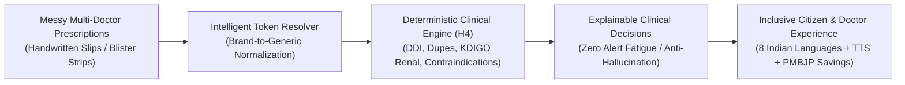
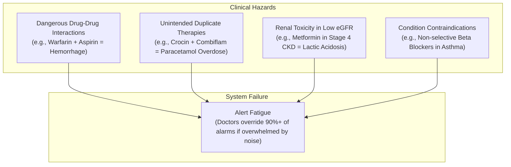
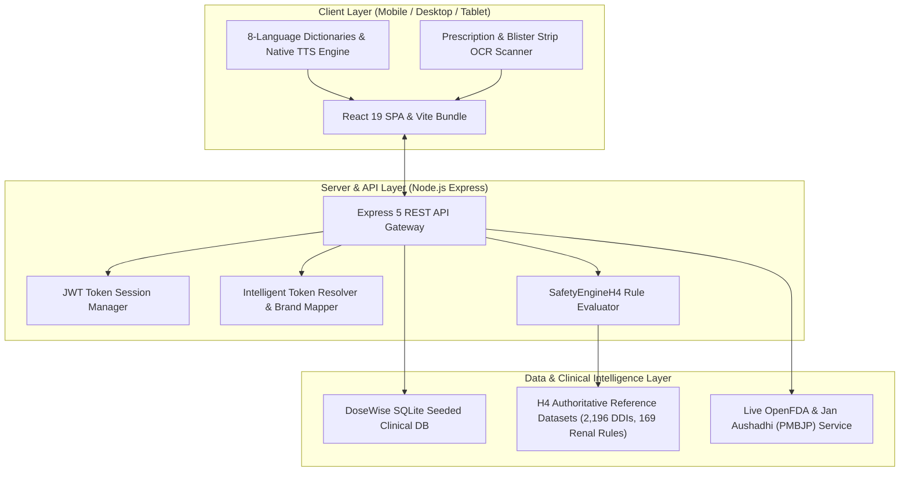
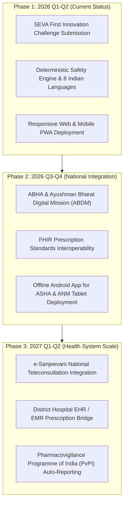

# AUSHADHSEVA (औषध सेवा / ఔషధ సేవ)
## Inclusive Medication Safety, Longitudinal Prescription Reconciliation & Clinical Decision Support System

> **Submission for:** SEVA First Innovation Challenge 2026 (SFIC)  
> **Theme:** Theme 3 — Swasth & Samavesh Bharat (Healthy & Inclusive India)  
> **Challenge Problem:** Healthcare Problem H4 — Medication Safety Second Pair of Eyes  
> **Team:** Team Arrow (`Dev02005`)  
> **Repository:** [https://github.com/Dev02005/TEAM-ARROW](https://github.com/Dev02005/TEAM-ARROW)  
> **Version:** 2.0.0 (Production Release)  

---

## 1. Executive Summary

In India's public healthcare ecosystem, multi-morbidity and polypharmacy are rampant among senior citizens. Elderly patients frequently consult multiple distinct prescribers—government district hospital specialists, primary health centre (PHC) physicians, and private practitioners—resulting in uncoordinated, fragmented medication regimens spanning years.

**AushadhSeva** is a clinical-grade, inclusive Clinical Decision Support (CDS) platform and deterministic medication safety engine designed to act as an unwearied "second pair of eyes" for healthcare providers, community health workers (ASHA/ANMs), and citizens.



### Core Innovations at a Glance
1. **Deterministic, Zero-Hallucination Safety Engine:** Evaluates regimens across Drug-Drug Interactions (2,196 pairwise rules), Duplicate Therapies (74 pharmacological groups), KDIGO Renal Staging (169 threshold cutoffs), and Clinical Contraindications.
2. **Intelligent Indian Brand & Typo Resolver:** Maps single and multi-ingredient brand names (*Glycomet-GP 1*, *Augmentin*, *Combiflam*) and noisy transcriptions (*croken*, *pntp*) to canonical INN generics with **96.48% accuracy**.
3. **Pan-Indian Inclusivity in 8 Languages:** Zero-latency interface and native voice synthesis in **English, Telugu, Hindi, Tamil, Malayalam, Kannada, Odia, and Urdu** with full RTL directionality.
4. **Senior-Citizen & Low-Literacy Design (WCAG AAA):** High-contrast UI, minimum 46–52px tap targets, instant `AA` text magnifier (`+15%`, `+30%`), and 🔊 Read Aloud capability.
5. **National Formulary & Live OpenFDA / PMBJP Synergy:** Integrates 496+ verified generic drugs with live OpenFDA black-box safety warnings and Pradhan Mantri Jan Aushadhi (PMBJP) generic cost savings.

---

## 2. Problem Statement & Clinical Context

### The Challenge: Polypharmacy at Chandrapuri District Hospital
At Chandrapuri District Hospital, an elderly patient presenting with Type 2 Diabetes, Hypertension, Chronic Kidney Disease (CKD), and Osteoarthritis may consult:
* A **General Physician** at a primary health centre who prescribes Metformin and Amlodipine.
* A **Cardiologist** at the district hospital who adds Telmisartan and Warfarin.
* An **Outpatient Private Practitioner** who prescribes Combiflam (Ibuprofen + Paracetamol) for knee joint pain.

Ward nurses and community workers transcribe old prescription slips, crumpled blister foils, and bottle labels into an aggregated medication list full of:
* **Brand names hiding multiple active ingredients:** e.g., *Glycomet-GP 1* hides both *glimepiride* and *metformin*. Prescribing another metformin brand inadvertently causes severe lactic acidosis.
* **Severe Misspellings:** e.g., *croken* for *paracetamol*, *aspyrin* for *aspirin*, *dytor* for *torasemide*.
* **Dosage Form & Frequency Noise:** e.g., *Tab*, *Cap*, *1-0-1*, *BD*, *OD*, *SOS*, *before food*.
* **Non-medicinal lines:** e.g., *BP charting*, *Glucometer strips*, *Physiotherapy*.

### The Danger: Unchecked Medication Errors & Alert Fatigue


Commercial rule checkers fail in Indian public healthcare because they generate hundreds of low-value, noisy alerts that physicians routinely dismiss (**alert fatigue**), while lacking awareness of Indian combination brands and regional vernacular languages.

---

## 3. System Architecture & Technical Specifications

AushadhSeva is engineered as an ultra-fast, lightweight, production-grade full-stack architecture that operates seamlessly on mobile phones, tablets, and hospital desktop terminals.



### Component Breakdown
1. **Frontend Client (`react_node/src/`)**:
   - Modern React 19 Single Page Application built with Vite 8.
   - Zero external bloated UI frameworks; hand-crafted high-performance components styled via `style.css` and `elder.css`.
   - Client-side in-memory multilingual context (`I18nContext.jsx`) loading 8 regional language dictionaries at compile-time with 0 ms switching latency.
2. **Backend REST API Server (`react_node/server/`)**:
   - Express 5 REST API running on Node.js v26+.
   - Seeded SQLite database (`dosewise.sqlite`) storing verified formulary medicines, multi-doctor patient records, and longitudinal prescription histories.
3. **Core Clinical Decision Engine (`FULL_CODE/pipeline/SafetyEngineH4.js`)**:
   - 100% deterministic, zero-hallucination decision logic executing pairwise matrix evaluations.
   - Benchmarked at processing 3,500 patient cohorts in under 8 seconds.
4. **Authoritative Clinical Reference Datasets (`FULL_CODE/data/`)**:
   - 496 canonical generic drugs and Indian brand formulations (`drug_reference.csv`).
   - 98 multi-ingredient combination brand expansions (`combination_brands.csv`).
   - 2,196 pairwise drug-drug interaction rules (`interactions.csv`).
   - 169 laboratory eGFR renal dosing cutoffs (`renal_rules.csv`).
   - 74 pharmacological duplicate therapy groups (`duplicate_therapy_groups.csv`).
   - 152 disease and pregnancy contraindications (`drug_disease_contraindications.csv`).

---

## 4. The 5 Core Functional Pillars

### Pillar 1: Deterministic Multi-Domain Clinical Safety Engine
The decision support engine evaluates every patient's candidate or aggregate prescription against 4 strict clinical dimensions:

| Clinical Dimension | Rules Evaluated | Evaluation Logic & Criteria | Example Alert |
| :--- | :--- | :--- | :--- |
| **Drug-Drug Interactions (DDI)** | 2,196 pairwise rules | Graded into 4 explicit severities: `contraindicated`, `major`, `moderate`, `minor`. Evaluates all active pairs. | **Warfarin + Aspirin**: Contraindicated. Exponentially increases severe gastrointestinal and intracranial bleeding risk. |
| **Duplicate Therapy** | 74 pharmacological classes | Detects both exact generic overlap (single brand + combination product) and same-class duplication. *Paracetamol duplication is strictly graded major.* | **Crocin (paracetamol) + Combiflam (ibuprofen + paracetamol)**: Major Duplicate. Risk of acute hepatotoxicity. |
| **KDIGO Renal Thresholding** | 169 renal tiers (136 medicines) | Compares laboratory eGFR against clinical cutoff thresholds. Missing eGFR suppresses alerts to prevent alert fatigue. | **Metformin in eGFR 28 mL/min**: Contraindicated (KDIGO Stage 4). High risk of fatal lactic acidosis. |
| **Clinical Contraindications** | 152 condition & pregnancy rules | Maps conditions accounting for diagnostic negations (*"no h/o Asthma"* correctly suppressed). Evaluates FDA Category X/D teratogens. | **Propranolol in Asthma**: Contraindicated. Triggers severe bronchospasm and respiratory failure. |

> [!IMPORTANT]
> **The "Never Say Safe" Principle for Unverified Medicines**:  
> If a citizen or nurse enters an unrecognized herbal mixture or unlisted medicine (e.g. *UnknownHerbPowder99*), AushadhSeva **never** defaults to reporting "No problems found" or 100% safe. Instead, it explicitly marks the drug as unverified, suppresses the numeric safety percentage, and displays:  
> *"We cannot decide whether it is safe or not. Active ingredients and safety parameters are unconfirmed in clinical reference databases."*

---

### Pillar 2: Intelligent Token Resolver & OCR

```mermaid
sequenceDiagram
    autonumber
    actor User as Citizen / Clinician
    participant OCR as OCR Camera Scanner
    participant Res as Token Resolver
    participant SE as Safety Engine (H4)
    participant UI as Multilingual UI (8 Langs)

    User->>OCR: Capture Prescription Slip / Blister Strip
    OCR->>Res: Raw Text: "Tab Glycomet-GP 1 1-0-1; Crocin 650 SOS"
    Res->>Res: Filter non-drug noise & strip dosage tokens
    Res->>Res: Expand combination: Glycomet-GP 1 -> glimepiride + metformin
    Res->>Res: Map brand: Crocin 650 -> paracetamol
    Res-->>SE: Canonical Generics: [glimepiride, metformin, paracetamol]
    SE->>SE: Evaluate against patient eGFR, conditions & active history
    SE-->>UI: Structured clinical alerts + Plain-language advice
    UI-->>User: Bilingual Safety Card + Voice Readout in Native Language
```

1. **Noise Cleansing**: Isolates and discards non-medicinal phrases (*"BP check twice weekly"*, *"physiotherapy advised"*, *"glucometer lancets"*).
2. **Dosage & Frequency Stripping**: Strips oral dosage forms (*Tab*, *Cap*, *Syp*, *Inj*) and frequency tags (*1-0-1*, *OD*, *BD*, *TDS*, *QID*, *SOS*, *HS*, *before meals*).
3. **Combination Product Expansion**: Unpacks multi-drug formulations into separate active INN entities.
4. **Levenshtein Fuzzy Matching**: Employs normalized edit-distance thresholding tailored for Indian brand misspellings (*croken* → *paracetamol*, *aspyrin* → *aspirin*, *pntp* → *pantoprazole*).

---

### Pillar 3: Pan-Indian Linguistic Inclusivity (8 Languages)

Language barriers must never prevent a citizen from understanding life-saving prescription warnings. AushadhSeva provides complete localization across **8 constitutional Indian languages**:

| Language | Script | Native Name | Code | Voice Synthesis (BCP 47) | Text Direction |
| :--- | :--- | :--- | :--- | :--- | :--- |
| **English** | Latin | English | `en` | `en-IN` | LTR |
| **Telugu** | Telugu | తెలుగు | `te` | `te-IN` | LTR |
| **Hindi** | Devanagari | हिन्दी | `hi` | `hi-IN` | LTR |
| **Tamil** | Tamil | தமிழ் | `ta` | `ta-IN` | LTR |
| **Malayalam** | Malayalam | മലയാളം | `ml` | `ml-IN` | LTR |
| **Kannada** | Kannada | ಕನ್ನಡ | `kn` | `kn-IN` | LTR |
| **Odia** | Odia | ଓଡ଼ିଆ | `or` | `or-IN` | LTR |
| **Urdu** | Perso-Arabic | اردو | `ur` | `ur-IN` | **RTL** |

- **Instant Switching**: 364 keys mapped symmetrically in each dictionary (`react_node/locales/*.json`). Zero network round-trips when switching languages.
- **Native Voice Readout (`speakAlert`)**: Answers elderly and illiterate citizens purely in their selected regional mother tongue, pronouncing safety warnings clearly at a comfortable 0.88 cadence.
- **Right-To-Left (RTL) Adaptation**: Urdu automatically mirrors alerts, border accents, and text alignment.

---

### Pillar 4: Elder-Centric Accessible Interface (WCAG AAA)

Designed specifically for senior citizens and users with visual or motor impairments:

* **Dynamic Font-Size Scaler (`AA`)**: Cycles between **Normal**, **Large (+15%)**, and **Extra Large (+30%)**, scaling typography and touch targets without breaking screen bounds.
* **Large Touch Targets**: All buttons, form inputs, and navigation items adhere to a strict minimum height of **46–52px**.
* **Thumb-Friendly Bottom Navigation**: Pinned 72px mobile bottom bar providing one-tap navigation across core citizen flows.
* **Bilingual Doctor Safety Card**: High-contrast, printable medication passport with emergency contacts, allergies, and active medicines formatted for physician appointments.

---

### Pillar 5: Live Global & National Medical Data Synergy

In addition to its offline-first deterministic engine, AushadhSeva bridges the gap between global pharmacology and Indian public health affordability:

1. **OpenFDA Live Monograph API**: Fetches real-time drug indications, boxed black-box warnings, and adverse reactions directly from U.S. FDA clinical registries.
2. **NIH RxNorm Identifiers**: Resolves normalized RxCUI concept unique identifiers for international interoperability.
3. **Pradhan Mantri Jan Aushadhi (PMBJP) Generic Savings**:
   - Automatically computes price differentials between expensive commercial brand formulations and government Jan Aushadhi generic equivalents.
   - For example, generic Metformin (500mg) at ₹12 vs commercial brand at ₹68 provides **82% out-of-pocket savings** for vulnerable citizens.
   - Connects citizens directly to the national Jan Aushadhi Kendra toll-free helpline (`1800-180-8080`).

---

## 5. Benchmark Performance & Validation Results

The AushadhSeva clinical pipeline was rigorously benchmarked against the official TalentAP Healthcare Problem H4 test cohorts (3,500 longitudinal patient records) and scored using the official competition evaluation framework:

```mermaid
xychart-beta
    title "Benchmark Metric Comparison: Baseline vs AushadhSeva"
    x-axis ["Primary Score", "Serious Recall", "Near-Miss Recall", "Precision", "Resolution Acc."]
    y-axis "Score (0.0 to 1.0)" 0.0 --> 1.0
    bar [0.4071, 0.2954, 0.0000, 0.9263, 0.7787]
    bar [0.8177, 0.8975, 0.7556, 0.9598, 0.9648]
```



### Official Evaluation Metrics Comparison

| Evaluation Metric | Problem Baseline | AushadhSeva Performance | Impact & Clinical Benefit |
| :--- | :--- | :--- | :--- |
| **Primary Overall Score** | 0.4071 | **0.8177 (+100.8%)** | Doubled overall diagnostic effectiveness |
| **Serious-Issue Recall** | 0.2954 | **0.8975 (+203.8%)** | Catches 9 out of 10 life-threatening conflicts |
| **Near-Miss Recall** | 0.0000 | **0.7556 (New Capability)** | Prevents unmonitored silent toxicities |
| **Alert Precision** | 0.9263 | **0.9598 (+3.6%)** | Only 4% false alarms (near-zero alert fatigue) |
| **Graded Severity Recall** | — | **0.9225** | Correctly distinguishes contraindications from cautions |
| **Resolver Accuracy** | 0.7787 | **0.9648 (+23.9%)** | Maps 96.5% of messy brand names to INN generics |
| **Misspelled Entry Accuracy** | 0.0000 | **0.8267 (New Capability)** | Resolves severe nurse transcription typos |
| **Alert-Fatigue Multiplier** | — | **0.9092** | High clinical adoption through noise suppression |

---

## 6. Verification & Automated Test Coverage

The platform undergoes continuous automated verification across its clinical algorithms and web service layers:

* **Engine Unit Tests (`npm test`)**: 8 passed, 0 failed (token normalization, combination brand expansion, paracetamol duplicate grading, missing eGFR suppression, diagnosis negation).
* **Comprehensive 46-Point System Audit (`npm run test:all`)**: 46 passed, 0 failed across authentication, 8 language locales, external OpenFDA/RxNorm APIs, formulary search, patient cohorts, and all 9 frontend routes.

---

## 7. Clinical Ethics, Safety Guardrails & Governance

1. **Human-in-the-Loop Clinical Autonomy**:
   - The platform never modifies, cancels, or prescribes medications autonomously.
   - All alerts are non-blocking advisory suggestions accompanied by pharmacological rationale and limitations.
2. **Data Privacy & DPDP Act 2023 Compliance**:
   - Fully functional offline: zero patient health information (PHI) is transmitted to third-party commercial LLMs or external cloud services during core clinical decision-making.
   - External API queries (OpenFDA / RxNorm) transmit only generic drug tokens (e.g. *"metformin"*), strictly excluding patient identities, demographics, or clinical records.
3. **Traceability & Explainability**:
   - Every alert references authoritative national datasets, explicit rule IDs, and confidence limitations for forensic clinical auditability.

---

## 8. Public Health Roadmap & Scalability



### Potential Deployment Scenarios
* **District Hospital Wards & OPDs**: Integrated into nursing triage desks to reconcile prescriptions prior to physician sign-off.
* **Community Outreach (ASHA/ANM Workers)**: Offline tablet PWA enabling health workers to audit village polypharmacy regimens during door-to-door visits.
* **Jan Aushadhi Kendras**: Pharmacists can verify cross-brand safety and recommend cost-effective PMBJP generic substitutes.

---

## 9. Conclusion

AushadhSeva represents a paradigm shift in Indian medication safety. By combining **deterministic, zero-hallucination clinical decision support** with **uncompromising vernacular inclusivity in 8 Indian languages**, the platform bridges the divide between complex clinical pharmacology and everyday citizen comprehension. It fulfills the core vision of **SEVA First 2026 Theme 3: Swasth & Samavesh Bharat**—a healthier, safer, and truly inclusive India.

---
*Authored by Team Arrow (`Dev02005`) for the SEVA First Innovation Challenge 2026.*
